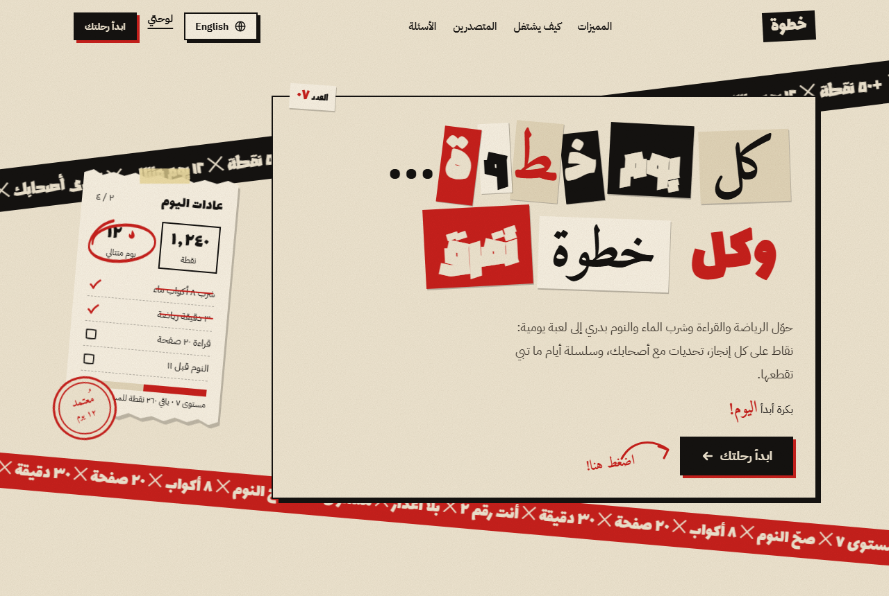
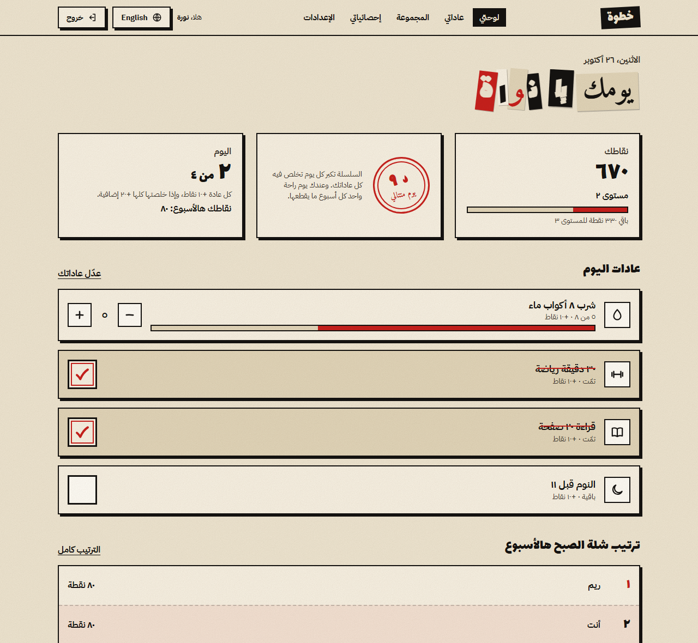
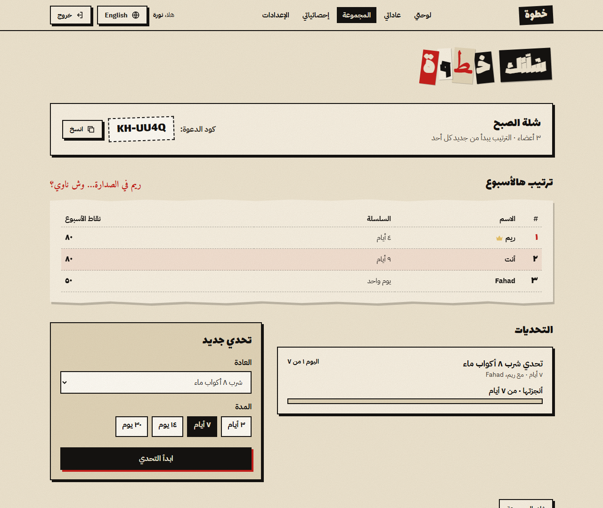
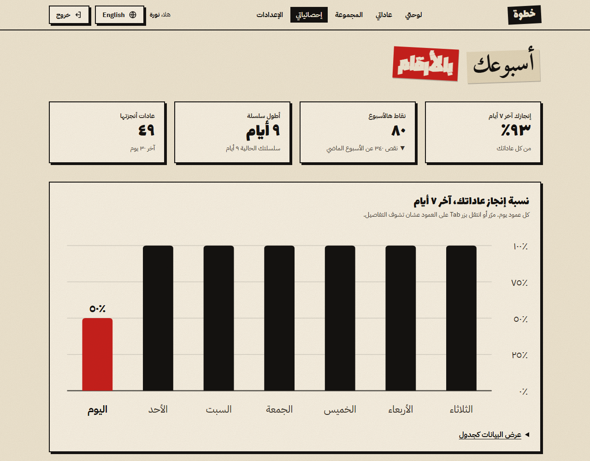
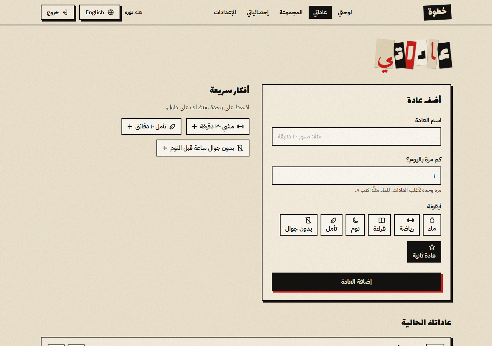
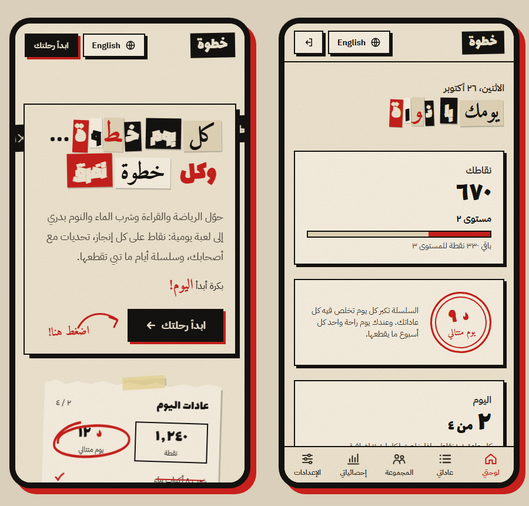
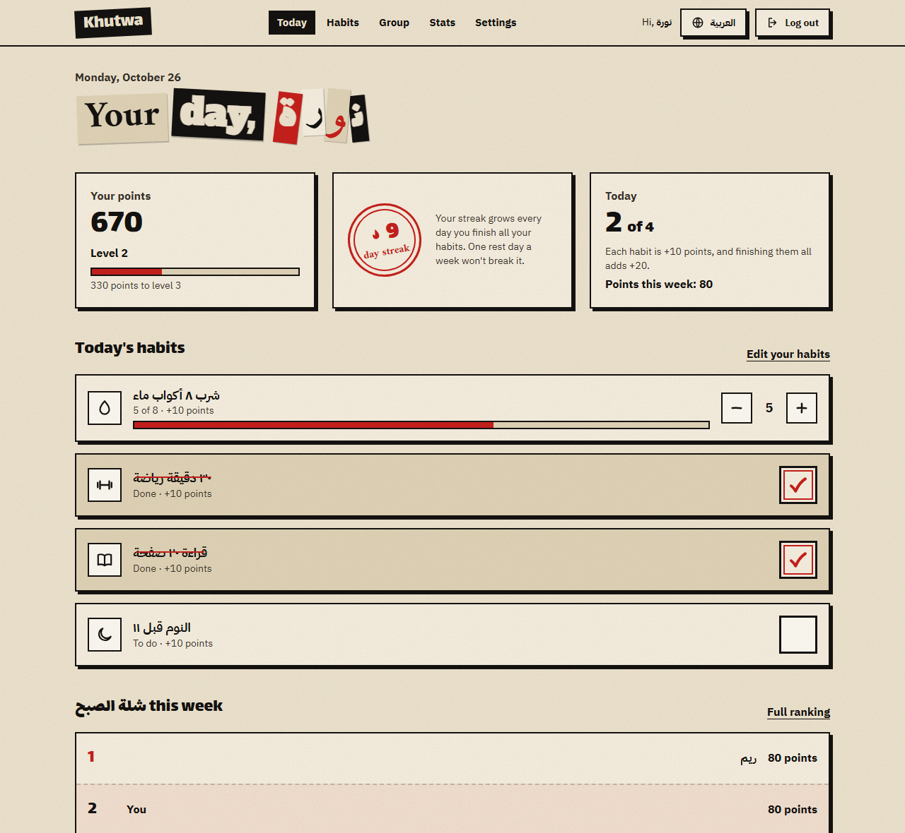
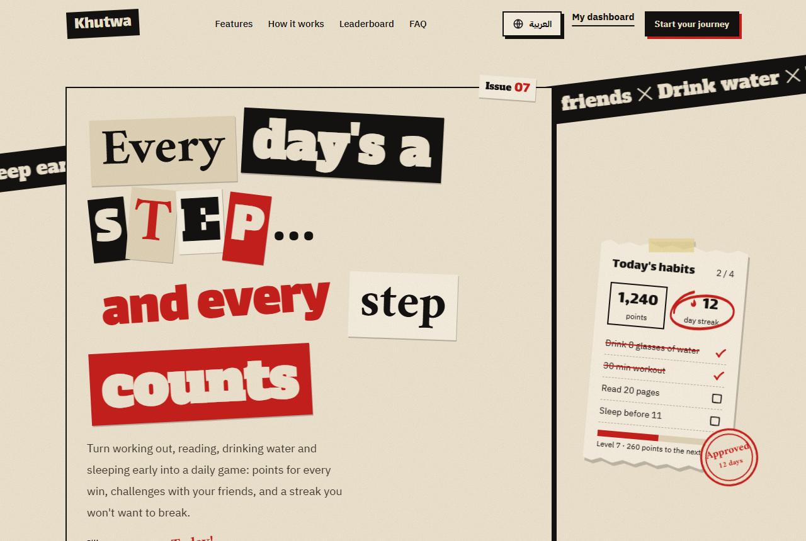

<div dir="rtl">

# خطوة · Khutwa

**كل يوم خطوة… وكل خطوة تفرق.**

موقع يساعد الطلاب والشباب (١٨–٣٠ سنة) يبنون عادات يومية صحية، مثل الرياضة والقراءة وشرب الماء والنوم بدري. كل عادة تنجزها تعطيك نقاط، وتقدر تتحدى أصحابك وتشوف ترتيبكم في لوحة متصدرين أسبوعية، وفيه سلسلة أيام متتالية تحفزك ما توقف.

التصميم مستوحى من **حركة الدادا** الفنية: قصاصات جرايد، وحروف مقصوصة مثل رسائل الفدية، وأختام وأشرطة لاصقة. والفوضى في العناوين والزخرفة بس، والنصوص والأزرار تظل واضحة ومقروءة.

[English below ⬇](#english)



## المميزات

- **تتبع العادات:** عادة مرة باليوم تنجزها بضغطة، أو عادة لها عدد (مثل ٨ أكواب ماء) بأزرار + و −.
- **النقاط والمستويات:** ١٠ نقاط لكل عادة، و٢٠ نقطة إضافية إذا خلصت كل عادات اليوم، ومستوى جديد كل ٥٠٠ نقطة.
- **سلسلة الأيام:** تزيد كل يوم تخلص فيه كل عاداتك، ويوم راحة واحد بالأسبوع ما يقطعها.
- **المجموعات والتحديات:** سوّ مجموعة وشارك كود الدعوة (مثل `KH-7Q2M-X4PA`)، وتنافسوا في ترتيب أسبوعي يبدأ من جديد كل أحد، وابدأوا تحديات لمدة ٣ أو ٧ أو ١٤ أو ٣٠ يوم.
- **إحصائيات أسبوعية:** نسبة الإنجاز لآخر ٧ أيام، ومقارنة بالأسبوع الماضي، وتقدم كل عادة لحالها.
- **لغتين:** عربي (من اليمين لليسار) وإنجليزي (من اليسار لليمين)، والأرقام والتواريخ والجمع تتبع اللغة.
- **الخصوصية:** تفاصيل عاداتك ما يشوفها غيرك، وتقدر تخفي نفسك من لوحة المتصدرين، وتحمّل نسخة من بياناتك أو تحذف حسابك نهائيًا.
- **يناسب الجوال:** قائمة سفلية على الشاشات الصغيرة، والميلان والفوضى يخفّون عشان القراءة.

## صور من الموقع

| لوحتي | المجموعة ولوحة المتصدرين |
|---|---|
|  |  |

| الإحصائيات | عاداتي |
|---|---|
|  |  |

| على الجوال | بالإنجليزي |
|---|---|
|  |  |

> الأسماء والأرقام في الصور بيانات تجريبية.

## التقنيات

| الجزء | التقنية |
|---|---|
| الواجهة | HTML5، و JavaScript عادي بدون إطار عمل، و CSS مخصص |
| التنسيق | Tailwind CSS 3.4.17 |
| الخطوط | Google Fonts: Amiri، Blaka، Lalezar، IBM Plex Sans Arabic، Alfa Slab One |
| الحسابات والبيانات | Supabase: تسجيل الدخول، وقاعدة بيانات PostgreSQL، وقواعد Row Level Security |
| مكتبة Supabase | supabase-js 2.117.0 |
| اللغات | نظام ترجمة مخصص، و Intl API للأرقام والتواريخ والجمع |

ما فيه خطوة بناء (build) ولا Node.js. الموقع ملفات ثابتة، تنفتح مباشرة في المتصفح أو تنرفع على أي استضافة ثابتة مثل GitHub Pages.

## هيكل الملفات

```
├── index.html          الصفحة الرئيسية + تسجيل الدخول وإنشاء الحساب
├── app.html            لوحتي: عادات اليوم والنقاط والسلسلة
├── habits.html         إضافة العادات وتعديلها وحذفها
├── group.html          المجموعة والترتيب والتحديات
├── stats.html          الإحصائيات الأسبوعية
├── settings.html       الإعدادات والخصوصية وبياناتك
├── privacy.html        سياسة الخصوصية
├── contact.html        تواصل معنا
├── options.html        خيارات التصميم الأولية (مرجع)
├── admin/              لوحة تحكم المدير (تحتاج حساب مدير)
├── assets/
│   ├── config.example.js  مثال لإعدادات Supabase (انسخه إلى config.js)
│   ├── store.js        طبقة البيانات: كل الاتصال بـ Supabase وقواعد النقاط
│   ├── i18n.js         نصوص العربي والإنجليزي
│   ├── ui.js           القوائم والأيقونات والتنبيهات
│   └── dada.css        ألوان وخطوط ومكونات التصميم
├── supabase/
│   ├── schema.sql      الجداول وقواعد الحماية والدوال
│   └── admin.example.sql  مثال لصلاحيات المدير (انسخه إلى admin.sql)
├── .github/workflows/deploy.yml  النشر التلقائي على GitHub Pages
└── screenshots/        صور الـ README
```

## التشغيل

### ١. جهّز Supabase
1. سوّ مشروع جديد في [supabase.com](https://supabase.com).
2. افتح **SQL Editor**، والصق محتوى `supabase/schema.sql` كامل، واضغط **Run**.
3. من **Project Settings ← API Keys**، انسخ **Project URL** و **Publishable key**.

### ٢. اربط الموقع
انسخ `assets/config.example.js` إلى ملف جديد اسمه `assets/config.js`، وحط فيه القيمتين:

```js
window.KHUTWA_CONFIG = {
  supabaseUrl: 'https://YOUR-PROJECT-REF.supabase.co',
  supabaseKey: 'sb_publishable_...',
};
```

ملف `config.js` مستبعد في `.gitignore`، فما ينرفع على GitHub.

### ٣. شغّل
افتح `index.html` في المتصفح. يحتاج اتصال بالإنترنت لأن الخطوط والمكتبات تتحمّل من الإنترنت.

### ٤. لوحة تحكم المدير (اختياري)
1. انسخ `supabase/admin.example.sql` إلى `supabase/admin.sql`، واكتب إيميل حسابك في آخر الملف.
2. سجّل في الموقع بنفس الإيميل، وبعدها شغّل `admin.sql` في **SQL Editor**.
3. افتح `admin/index.html` (أو `/admin/` في الموقع المنشور) وادخل بحسابك.

اللوحة فيها: الرئيسية، والإحصائيات العامة، وإدارة العضويات، والأفكار السريعة، وطلبات الاتصال. كل صلاحياتها محمية في قاعدة البيانات، فما تعرض شي لحساب مو مدير.

### ٥. النشر على GitHub Pages
1. **Settings ← Secrets and variables ← Actions ← New repository secret**، وأضف:
   - `SUPABASE_URL`
   - `SUPABASE_PUBLISHABLE_KEY`
2. **Settings ← Pages ← Source: GitHub Actions**.
3. كل رفع على `main` ينشر الموقع تلقائيًا، ويكتب `config.js` من الأسرار وقت النشر.
4. في Supabase، من **Authentication ← URL Configuration**، حط رابط الموقع في **Site URL** و **Redirect URLs**.

## الأمان

- **ما فيه أي مفتاح في المستودع:** `config.js` و `admin.sql` مستبعدين، والموجود منهم نسخ أمثلة بس. وقت النشر، المفتاح العام ينكتب في الموقع من أسرار GitHub.
- **المفتاح العام (publishable) مصمم إنه يوصل للمتصفح.** الحماية الحقيقية في قواعد **Row Level Security** داخل `schema.sql`:
  - كل مستخدم يقرأ ويعدّل بياناته بس.
  - أعضاء المجموعة يشوفون الاسم والنقاط والسلسلة بس.
  - اللي يختار الإخفاء ما يظهر لأحد.
- **لا تحط في المشروع أبد:**
  - مفتاح **Secret** أو **service_role** من Supabase.
  - كلمة مرور قاعدة البيانات.
  - أي توكن ثاني.

  ملفات `.env` و `config.js` و `admin.sql` مستبعدة في `.gitignore`.
- **قبل فتح الموقع للعامة:**
  - شغّل **Confirm email** واربط خدمة إيميل (SMTP).
  - شغّل CAPTCHA.

## الحقوق

© ٢٠٢٦ خطوة. جميع الحقوق محفوظة.

</div>

---

<a id="english"></a>

# Khutwa · خطوة

**Every day is a step… and every step counts.**

A website that helps students and young people (18–30) build healthy daily habits, like working out, reading, drinking water and sleeping early. Every habit you finish earns points, you can challenge your friends on a weekly leaderboard, and a day streak keeps you going.

The design is inspired by the **Dada** art movement: newspaper clippings, ransom-note letters, stamps and tape. The chaos stays in headlines and decoration; body text and buttons stay clear and readable.



## Features

- **Habit tracking:** one-tap habits, or counted habits (like 8 glasses of water) with + and − buttons.
- **Points & levels:** 10 points per habit, a 20-point bonus for finishing every habit of the day, and a new level every 500 points.
- **Day streaks:** grow every day you finish all your habits; one rest day a week won't break them.
- **Groups & challenges:** create a group and share its invite code (e.g. `KH-7Q2M-X4PA`), compete on a weekly ranking that resets every Sunday, and start 3, 7, 14 or 30-day challenges.
- **Weekly stats:** completion rate for the last 7 days, a comparison with last week, and progress per habit.
- **Two languages:** Arabic (right-to-left) and English (left-to-right); numbers, dates and plurals follow the language.
- **Privacy:** nobody else sees the details of your habits; you can hide yourself from the leaderboard, download a copy of your data, or delete your account for good.
- **Mobile-friendly:** a bottom navigation bar on small screens, with the tilt and clutter toned down for readability.

## Screenshots

| Dashboard | Group & leaderboard |
|---|---|
|  |  |

| Stats | Habits |
|---|---|
|  |  |

| Mobile | English |
|---|---|
|  |  |

> Names and numbers in the screenshots are sample data.

## Tech stack

| Part | Technology |
|---|---|
| Front end | HTML5, plain JavaScript (no framework), custom CSS |
| Styling | Tailwind CSS 3.4.17 |
| Fonts | Google Fonts: Amiri, Blaka, Lalezar, IBM Plex Sans Arabic, Alfa Slab One |
| Accounts & data | Supabase: Auth, PostgreSQL, Row Level Security |
| Supabase client | supabase-js 2.117.0 |
| Languages | Custom i18n system, plus the Intl API for numbers, dates and plurals |

There is no build step and no Node.js. The site is static files that open directly in a browser or deploy to any static host, such as GitHub Pages.

## Project structure

```
├── index.html          Landing page + sign-in and sign-up
├── app.html            Dashboard: today's habits, points and streak
├── habits.html         Add, edit and delete habits
├── group.html          Group, ranking and challenges
├── stats.html          Weekly stats
├── settings.html       Settings, privacy and your data
├── privacy.html        Privacy policy
├── contact.html        Contact form
├── options.html        Early design options (reference)
├── admin/              Admin dashboard (requires an admin account)
├── assets/
│   ├── config.example.js  Example Supabase settings (copy to config.js)
│   ├── store.js        Data layer: all Supabase access and scoring rules
│   ├── i18n.js         Arabic and English text
│   ├── ui.js           Navigation, icons and toasts
│   └── dada.css        Design colors, fonts and components
├── supabase/
│   ├── schema.sql      Tables, security rules and functions
│   └── admin.example.sql  Example admin permissions (copy to admin.sql)
├── .github/workflows/deploy.yml  Automatic deploy to GitHub Pages
└── screenshots/        README images
```

## Getting started

### 1. Set up Supabase
1. Create a new project at [supabase.com](https://supabase.com).
2. Open **SQL Editor**, paste the whole of `supabase/schema.sql`, and click **Run**.
3. From **Project Settings → API Keys**, copy the **Project URL** and the **Publishable key**.

### 2. Connect the site
Copy `assets/config.example.js` to a new file named `assets/config.js` and put both values in it:

```js
window.KHUTWA_CONFIG = {
  supabaseUrl: 'https://YOUR-PROJECT-REF.supabase.co',
  supabaseKey: 'sb_publishable_...',
};
```

`config.js` is excluded in `.gitignore`, so it never reaches GitHub.

### 3. Run
Open `index.html` in a browser. An internet connection is needed because the fonts and libraries load from the web.

### 4. Admin dashboard (optional)
1. Copy `supabase/admin.example.sql` to `supabase/admin.sql` and put your account's email at the bottom.
2. Sign up on the site with that email, then run `admin.sql` in the **SQL Editor**.
3. Open `admin/index.html` (or `/admin/` on the published site) and sign in with your account.

The dashboard has a home page, general stats, member management, quick ideas and contact requests. Every permission is enforced in the database, so it shows nothing to an account that isn't an admin.

### 5. Deploy to GitHub Pages
1. **Settings → Secrets and variables → Actions → New repository secret**, and add:
   - `SUPABASE_URL`
   - `SUPABASE_PUBLISHABLE_KEY`
2. **Settings → Pages → Source: GitHub Actions**.
3. Every push to `main` deploys the site and writes `config.js` from the secrets at deploy time.
4. In Supabase, under **Authentication → URL Configuration**, set the site's address as the **Site URL** and add it to **Redirect URLs**.

## Security

- **No key is stored in the repository:** `config.js` and `admin.sql` are excluded, and only example copies are included. At deploy time the publishable key is written into the site from GitHub secrets.
- **The publishable key is designed to reach the browser.** The real protection is the **Row Level Security** rules in `schema.sql`:
  - Each user can read and change only their own data.
  - Group members see only each other's name, points and streak.
  - Anyone who chooses to hide is visible to nobody.
- **Never put any of these in the project:**
  - A Supabase **secret** or **service_role** key.
  - The database password.
  - Any other token.

  `.env`, `config.js` and `admin.sql` are excluded in `.gitignore`.
- **Before opening the site to the public:**
  - Turn on **Confirm email** with an SMTP provider.
  - Enable CAPTCHA.

## Copyright

© 2026 Khutwa. All rights reserved.
